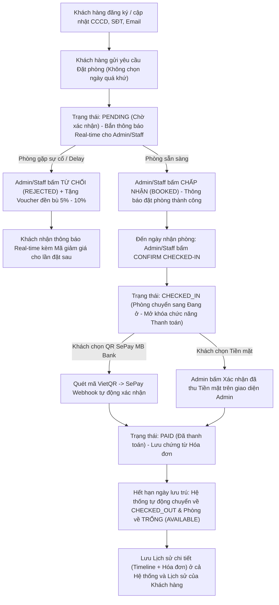

# 🏨 Hệ Thống Quản Lý Homestay / Khách Sạn Thông Minh (Homestay Pro - J2EE Spring Boot)

Đồ án môn học **Lập trình J2EE** xây dựng hệ thống quản lý Homestay / Khách sạn toàn diện theo thời gian thực (**Real-time Server-Sent Events**), tích hợp phân quyền đa vai trò (**RBAC**), quy trình phê duyệt đặt phòng – đền bù mã giảm giá tự động, thanh toán trực tuyến qua **QR SePay (MB Bank)** và xuất báo cáo chuẩn **PDF JasperReports**.

---

## 🚀 1. Công Nghệ Sử Dụng
- **Backend:** Java 21, Spring Boot 4.0, Spring Security 6 (Form Login & Google OAuth2), Spring Data JPA (Hibernate), Bean Validation.
- **Real-time Engine:** Server-Sent Events (`SseEmitter` + `EventSource`) giúp đồng bộ tức thì đơn đặt phòng, danh sách khách hàng, thông báo chuông (Live Bell) và trạng thái phòng mà không cần tải lại trang.
- **Cơ sở dữ liệu:** MySQL 8.x (`homestay_db`).
- **Frontend:** Thymeleaf, Bootstrap 5, Bootstrap Icons, JavaScript ES6.
- **Tích hợp thanh toán & Tiện ích:**
  - **Cổng thanh toán QR SePay (MB Bank / VietQR):** Sinh mã QR động theo số tiền thực thu, nhận Webhook thời gian thực (`/api/payment/sepay-webhook`) & tự động chuyển trạng thái **Đã thanh toán (`PAID`)**.
  - **JasperReports PDF:** Kết xuất 6 loại báo cáo quản trị & phiếu in hóa đơn định dạng PDF.
  - **Trợ lý ảo AI (Google Gemini API)** & **Gửi Email tự động (Spring Mail SMTP)**.

---

## 🔐 2. Phân Quyền Hệ Thống (3 Nhóm Vai Trò Chặt Chẽ)

| Chức năng | Quản trị viên (`ADMIN`) | Nhân viên Lễ tân (`STAFF`) | Khách hàng (`CUSTOMER`) |
| :--- | :---: | :---: | :---: |
| Xem Dashboard & Thống kê doanh thu | Toàn quyền (Có doanh thu) | Xem tình trạng buồng phòng | Chỉ xem tổng quan phòng trống |
| Quản lý Phòng, Loại phòng, Dịch vụ | Thêm / Sửa / Xóa | Thêm / Sửa / Xóa | Chỉ xem danh sách & giá niêm yết |
| Bảo mật thông tin khách đang ở | Xem tên khách đang lưu trú | Xem tên khách đang lưu trú | **Ẩn tuyệt đối tên khách đang ở** (Chỉ hiện trạng thái & ngày phòng trống) |
| Quản lý Hồ sơ Khách hàng (`/customers`) | Toàn quyền (Đồng bộ Real-time) | Toàn quyền (Đồng bộ Real-time) | Quản lý hồ sơ cá nhân tại `/profile` |
| Đặt phòng (`/bookings/new`) | Đặt hộ khách tại quầy | Đặt hộ khách tại quầy | Đặt bằng thông tin cá nhân của chính mình (Chặn chọn ngày quá khứ) |
| Duyệt / Từ chối đơn & Tặng mã đền bù 5–10% | ✅ Có | ✅ Có | Nhận thông báo & mã giảm giá Real-time |
| Confirm Checked-in & Mở khóa Thanh toán | ✅ Có | ✅ Có | Mở khóa Thanh toán sau khi được Confirm |
| Thanh toán Online QR SePay / Tiền mặt | Xác nhận thu Tiền mặt 1 chạm | Xác nhận thu Tiền mặt 1 chạm | Tự chọn quét **QR SePay MB Bank** hoặc yêu cầu trả Tiền mặt |
| Trung tâm Báo cáo PDF (`/reports`) | ✅ Toàn quyền | ❌ Khóa | ❌ Khóa |
| Quản lý Tài khoản & Phân quyền (`/users`) | ✅ Toàn quyền | ❌ Khóa | ❌ Khóa |

---

## 🔄 3. Quy Trình Nghiệp Vụ Đặt Phòng & Thanh Toán Thực Tế



---

## 👤 4. Tài Khoản Mặc Định Để Kiểm Thử

Hệ thống tự động khởi tạo 3 tài khoản mặc định qua `DataInitializer` với trạng thái vận hành mới (5 phòng trống `AVAILABLE`, 1 phòng bảo trì `MAINTENANCE`, doanh thu `0 đ`):

| Vai trò | Tên đăng nhập | Mật khẩu | Ghi chú |
| :--- | :--- | :--- | :--- |
| **Quản trị viên (`ADMIN`)** | `admin` | `admin123` | Toàn quyền hệ thống, duyệt đơn, xem doanh thu & xuất báo cáo PDF |
| **Nhân viên (`STAFF`)** | `staff` | `staff123` | Nghiệp vụ lễ tân, duyệt đơn, Confirm Check-in, xác nhận thanh toán |
| **Khách hàng (`CUSTOMER`)** | `customer` | `admin123` | Cập nhật CCCD/SĐT tại `/profile`, đặt phòng & thanh toán QR SePay |

---

## ⚙️ 5. Hướng Dẫn Cài Đặt & Chạy Dự Án

1. **Khởi tạo Cơ sở dữ liệu MySQL:**
   - Tạo database `homestay_db` trên MySQL (`localhost:3306`) hoặc chạy script [`database/schema.sql`](database/schema.sql) và [`database/data.sql`](database/data.sql).
2. **Cấu hình bảo mật cục bộ (`application-local.properties`):**
   - Tạo file `src/main/resources/application-local.properties` (file này đã được đưa vào `.gitignore` để bảo mật thông tin ngân hàng và khóa API):
     ```properties
     sepay.bank.name=MBBank
     sepay.bank.account=SO_TAI_KHOAN_CUA_BAN
     sepay.bank.account-name=TEN_CHU_TAI_KHOAN
     sepay.transfer.prefix=HOMESTAY
     sepay.api.key=MA_API_KEY_WEBHOOK_SEPAY
     ```
3. **Chạy ứng dụng:**
   ```bash
   mvn spring-boot:run
   ```
4. Truy cập tại: `http://localhost:8080`
